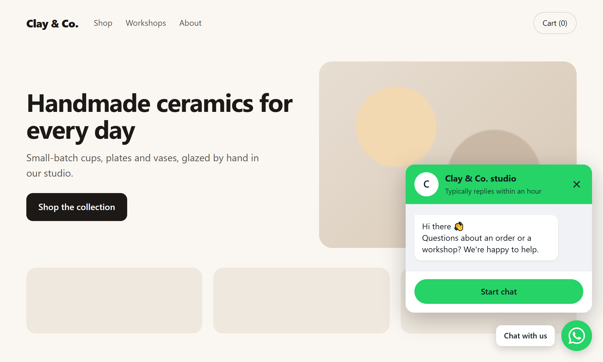
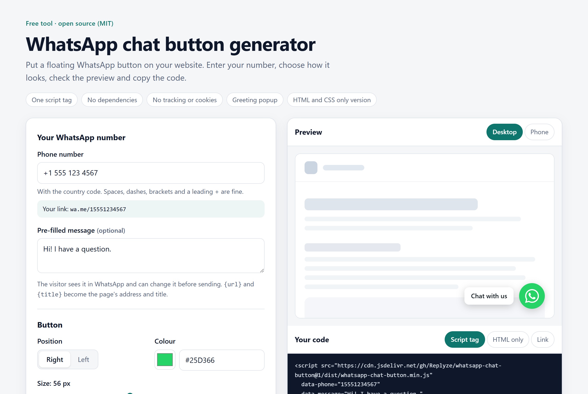

<p align="center">
  <a href="https://replyze.chat/?utm_source=github&utm_medium=referral&utm_campaign=whatsapp-chat-button">
    <picture>
      <source media="(prefers-color-scheme: dark)" srcset="https://raw.githubusercontent.com/Replyze/.github/main/assets/logo-on-dark.png">
      
    </picture>
  </a>
</p>

# WhatsApp chat button for your website

Free, no dependencies, no tracking. A floating WhatsApp button for any website in one `<script>` tag: your number, a pre-filled message and an optional greeting popup. There is also a pure HTML and CSS version for places that don't allow scripts. It's for anyone who wants visitors to reach them on WhatsApp, on plain HTML, WordPress, Shopify, Wix, Squarespace, Webflow, Google Tag Manager, React or Next.js.

<p align="center">
  
</p>

<p align="center"><b><a href="https://replyze.github.io/whatsapp-chat-button/">Open the generator</a></b>: enter your number, see a live preview, copy the code.</p>

- One script tag, 4.2 KB gzipped, no dependencies
- Works with any WhatsApp number: no WhatsApp Business account or API needed
- Optional greeting popup with your name, photo and a "Start chat" button
- Shows after N seconds or after scrolling; hides on phones or on desktops if you want
- Lives in its own Shadow DOM: your site's CSS can't break it, and its CSS can't reach your site
- Accessible: a real link or button, keyboard and Esc, screen reader names, visible focus, reduced motion
- Private: no cookies, no storage, no requests of its own
- Works under a strict Content-Security-Policy, Trusted Types included
- An HTML and CSS only version with no JavaScript at all

## Contents

[Quick start](#quick-start) · [Generator](#generator) · [Options](#options) · [Greeting popup](#greeting-popup) · [JavaScript API](#javascript-api) ·
[HTML](#plain-html) · [WordPress](#wordpress) · [Shopify](#shopify) · [Wix](#wix) · [Squarespace](#squarespace) · [Webflow](#webflow) · [Google Tag Manager](#google-tag-manager) · [React and Next.js](#react-and-nextjs) ·
[HTML and CSS only](#html-and-css-only-no-javascript) · [Content-Security-Policy](#content-security-policy) · [Accessibility](#accessibility) · [Privacy](#privacy) · [Browser support](#browser-support) · [FAQ](#faq) · [Brand and trademarks](#brand-and-trademarks) · [Development](#development) · [Shared inbox](#need-a-shared-inbox-for-whatsapp)

## Quick start

<!-- test: quick-start -->
```html
<script src="https://cdn.jsdelivr.net/gh/Replyze/whatsapp-chat-button@1/dist/whatsapp-chat-button.min.js"
  data-phone="+1 555 123 4567"
  data-message="Hi! I have a question."
  defer></script>
```

1. Put your own number in `data-phone`, with the country code. Spaces, dashes, brackets and a `+` are fine.
2. Paste the tag right before `</body>` on every page, or once in the layout or footer that every page shares.

A click opens a WhatsApp chat with you, with the message already typed in. The visitor can change it before sending.

`@1` in the URL gets every 1.x update and nothing that breaks your setup. To pin one exact version and let the browser check the file ([Subresource Integrity](https://developer.mozilla.org/en-US/docs/Web/Security/Subresource_Integrity)):

<!-- test: pinned -->
```html
<script src="https://cdn.jsdelivr.net/gh/Replyze/whatsapp-chat-button@1.0.0/dist/whatsapp-chat-button.min.js"
  integrity="sha384-qRyYCzazdi3+qtuxji/2e0RDzIt3sy5h8tdJQOKviN6752yr4RpuNMy5FPO2uTJ5"
  crossorigin="anonymous"
  data-phone="+1 555 123 4567"
  defer></script>
```

Rather not load it from a CDN? Download [`dist/whatsapp-chat-button.min.js`](dist/whatsapp-chat-button.min.js), upload it to your site and point `src` at your copy.

## Generator

[replyze.github.io/whatsapp-chat-button](https://replyze.github.io/whatsapp-chat-button/) writes the tag for you: fill in the fields, watch the preview on a desktop or a phone, copy the code. It also writes the [HTML and CSS only](#html-and-css-only-no-javascript) version and the plain link. It is `index.html` in this repository and runs entirely in your browser.

<p align="center">
  
</p>

## Options

Every option works as a `data-` attribute on the script tag, or as a property of `window.WhatsAppChatButtonConfig` ([below](#options-as-a-javascript-object)). Only the phone number is required.

| Attribute | JavaScript | Default | What it does |
|---|---|---|---|
| `data-phone` | `phone` | required | Your WhatsApp number with the country code, in any format: `+1 (555) 123-4567`, `0044 20 7946 0958` and `+44 (0)20 7946 0958` all work. The script keeps the digits. |
| `data-message` | `message` | none | Text typed into the chat for the visitor. `{url}` and `{title}` become the page's address and title at the moment of the click. |
| `data-position` | `position` | `right` | `right` or `left`. |
| `data-offset-x` | `offsetX` | `20` | Distance from the side of the screen, in pixels. |
| `data-offset-y` | `offsetY` | `20` | Distance from the bottom, in pixels. On iPhones it also clears the home bar. |
| `data-size` | `size` | `56` | Button size in pixels, from 32 to 96. |
| `data-color` | `color` | `#25D366` | Button colour, any CSS colour. The WhatsApp icon on it stays white. |
| `data-label` | `label` | none | Text in a bubble next to the button, for example `Chat with us`. |
| `data-label-hover` | `labelHover` | `false` | Show the label only on hover and keyboard focus, like a tooltip. |
| `data-greeting` | `greeting` | none | Turns on the [greeting popup](#greeting-popup) with this text. |
| `data-name` | `name` | none | Popup: your name or your business's name. |
| `data-subtitle` | `subtitle` | none | Popup: a line under the name, for example `Typically replies within an hour`. |
| `data-avatar` | `avatar` | none | Popup: URL of a photo or logo (`https:`, relative or `data:`). Without one, the first letter of the name. |
| `data-cta` | `cta` | `Start chat` | Popup: the text of the button that opens WhatsApp. |
| `data-popup-delay` | `popupDelay` | `0` | Popup: open it by itself after this many seconds. `0` means only on click. |
| `data-show-after` | `showAfter` | `0` | Show the button after this many seconds. |
| `data-show-on-scroll` | `showOnScroll` | none | Show the button once the visitor scrolls: `50%` of the page, or `300` pixels. With `show-after` too, whichever comes first. |
| `data-hide-on-mobile` | `hideOnMobile` | `false` | Hide on screens narrower than the breakpoint. |
| `data-hide-on-desktop` | `hideOnDesktop` | `false` | Hide on screens as wide as the breakpoint or wider. |
| `data-breakpoint` | `breakpoint` | `768` | The width in pixels that separates "mobile" from "desktop". |
| `data-z-index` | `zIndex` | `9999` | Stacking order, if something covers the button or the button covers something. |
| `data-new-tab` | `newTab` | `true` | Open WhatsApp in a new tab. `false`: in the same tab. |
| `data-aria-label` | `ariaLabel` | `Chat on WhatsApp` | What screen readers announce when there is no label. Translate it for your site. |
| `data-close-label` | `closeLabel` | `Close` | Popup: what screen readers announce for the close button. |

In `data-` attributes, a switch is on when the attribute is there with no value or with `"true"`, and off with `"false"`. For a line break in `data-message` or `data-greeting`, write `&#10;`.

### Options as a JavaScript object

<!-- test: config-object -->
```html
<script>
  window.WhatsAppChatButtonConfig = {
    phone: '+44 20 7946 0958',
    message: 'Hi! I am looking at {title}: {url}',
    position: 'left',
    label: 'Questions? Chat with us',
    name: 'Support team',
    subtitle: 'Typically replies within an hour',
    greeting: 'Hi there 👋\nHow can we help you?',
    popupDelay: 8
  };
</script>
<script src="https://cdn.jsdelivr.net/gh/Replyze/whatsapp-chat-button@1/dist/whatsapp-chat-button.min.js" defer></script>
```

The object has to be there before the script runs. If the script tag also has `data-` attributes, the object wins where both set the same option. A different message on some pages is one line in those pages' templates: `window.WhatsAppChatButtonConfig = { message: '...' }`.

## Greeting popup

Add `data-greeting` and the button opens a small popup first. Its "Start chat" button opens WhatsApp.

<!-- test: popup -->
```html
<script src="https://cdn.jsdelivr.net/gh/Replyze/whatsapp-chat-button@1/dist/whatsapp-chat-button.min.js"
  data-phone="+1 555 123 4567"
  data-message="Hi! I have a question."
  data-name="Support team"
  data-subtitle="Typically replies within an hour"
  data-greeting="Hi there 👋&#10;How can we help you?"
  defer></script>
```

- Esc or the × closes it, and the keyboard focus goes back to the button.
- The header and the "Start chat" text turn white or dark, whichever is easier to read on your colour.
- With `data-popup-delay="10"` it opens by itself after 10 seconds. It doesn't move the keyboard focus, and it doesn't come back if the visitor already opened and closed it. Nothing is stored, so it opens again on the next page load: use it on a landing page rather than on every page.

## JavaScript API

| Call | What it does |
|---|---|
| `WhatsAppChatButton.init(options)` | Builds the button from these options (all of [Options](#options), in their JavaScript names), replacing the one on the page. |
| `WhatsAppChatButton.open()` | Opens the popup. Without a popup, opens the WhatsApp chat: call it from a click, or the browser may block the new tab. |
| `WhatsAppChatButton.close()` | Closes the popup. |
| `WhatsAppChatButton.show()` / `hide()` | Shows or hides the button. |
| `WhatsAppChatButton.destroy()` | Removes the button and everything it listens to. |
| `WhatsAppChatButton.version` | `"1.0.0"` |

Only during business hours, for example from 9:00 to 17:00 in New York:

<!-- test: hours -->
```html
<script src="https://cdn.jsdelivr.net/gh/Replyze/whatsapp-chat-button@1/dist/whatsapp-chat-button.min.js" defer></script>
<script>
  document.addEventListener('DOMContentLoaded', function () {
    var hour = Number(new Intl.DateTimeFormat('en-US', {
      hour: 'numeric', hourCycle: 'h23', timeZone: 'America/New_York'
    }).format(new Date()));
    if (hour >= 9 && hour < 17) {
      WhatsAppChatButton.init({ phone: '+1 555 123 4567', message: 'Hi! I have a question.' });
    }
  });
</script>
```

A script tag with no `data-phone` waits for `init()`.

## Plain HTML

Paste the [quick start](#quick-start) tag right before `</body>` on every page, or once in the layout every page uses: `_layouts/default.html` in Jekyll, `layouts/_default/baseof.html` in Hugo, your base layout in Eleventy or Astro.

## WordPress

Two ways, pick one:

1. **A header and footer plugin**, such as WPCode: Code Snippets → Header & Footer, paste the tag into the **Footer** box, save.
2. **Your child theme's** `functions.php`:

```php
add_action( 'wp_footer', function () {
	?>
	<script src="https://cdn.jsdelivr.net/gh/Replyze/whatsapp-chat-button@1/dist/whatsapp-chat-button.min.js"
	  data-phone="+1 555 123 4567"
	  data-message="Hi! I have a question."
	  defer></script>
	<?php
} );
```

Use a child theme for this: a theme update replaces the parent theme's `functions.php`.

- A caching or optimization plugin that delays JavaScript (for example "Delay JavaScript execution" in WP Rocket) shows the button only after the visitor's first interaction. To show it at once, exclude `whatsapp-chat-button` there.
- WooCommerce is WordPress, so the same steps apply. `data-message="Hi! I have a question about {title}"` names the product the visitor is looking at.
- On WordPress.com, plugins and theme files are only on plans that allow plugins.

## Shopify

1. Shopify admin → **Online Store → Themes**.
2. On your current theme, open the menu (**…**) → **Edit code**.
3. Open **Layout → theme.liquid**.
4. Paste the tag right before `</body>` and click **Save**.

The button shows on every page your theme renders. Shopify's checkout doesn't use your theme's code, so it isn't there. `{title}` in the message names the product on product pages. If you switch themes, paste the tag into the new one.

## Wix

Custom code needs a paid Wix plan.

1. Wix dashboard → **Settings → Custom Code** (under Advanced).
2. **+ Add Custom Code**, paste the tag.
3. **Add Code to Pages: All pages** (load once), **Place Code in: Body - end**.
4. **Apply**.

## Squarespace

Code Injection needs a paid plan that includes it.

1. Open **Code Injection** (Settings → Advanced → Code Injection on most sites).
2. Paste the tag into the **Footer** box and **Save**.

## Webflow

1. **Site settings** (Project settings in older dashboards) → **Custom code**.
2. Paste the tag into **Footer code** and **Save changes**.
3. **Publish** the site.

Custom code runs on the published site, not in the Designer, and only on Webflow plans that allow it.

## Google Tag Manager

1. **Tags → New → Tag Configuration → Custom HTML**.
2. Paste this (the object form, so it doesn't matter how Tag Manager re-inserts the script tag):

<!-- test: gtm -->
```html
<script>
  window.WhatsAppChatButtonConfig = {
    phone: '+1 555 123 4567',
    message: 'Hi! I have a question.'
  };
</script>
<script src="https://cdn.jsdelivr.net/gh/Replyze/whatsapp-chat-button@1/dist/whatsapp-chat-button.min.js" async></script>
```

3. **Triggering: All Pages**.
4. Save, then **Submit** to publish the container.

## React and Next.js

**Next.js, App Router**, in `app/layout.tsx`:

```tsx
import Script from 'next/script';

export default function RootLayout({ children }: { children: React.ReactNode }) {
  return (
    <html lang="en">
      <body>
        {children}
        <Script
          src="https://cdn.jsdelivr.net/gh/Replyze/whatsapp-chat-button@1/dist/whatsapp-chat-button.min.js"
          data-phone="+1 555 123 4567"
          data-message="Hi! I have a question."
          strategy="afterInteractive"
        />
      </body>
    </html>
  );
}
```

**Pages Router**: the same `<Script>` in `pages/_app.tsx`, next to `<Component {...pageProps} />`. In both, the button stays across client-side navigation, and `{url}` and `{title}` follow the current page.

**React** (Vite, Create React App): the simplest way is the [quick start](#quick-start) tag before `</body>` in `index.html`. As a component instead, rendered once near the root of your app:

<!-- test: react -->
```jsx
import { useEffect } from 'react';

const SRC = 'https://cdn.jsdelivr.net/gh/Replyze/whatsapp-chat-button@1/dist/whatsapp-chat-button.min.js';

export default function WhatsAppButton(props) {
  const options = JSON.stringify(props);

  useEffect(() => {
    const config = JSON.parse(options);
    if (window.WhatsAppChatButton) {
      window.WhatsAppChatButton.init(config);
    } else {
      window.WhatsAppChatButtonConfig = config;
      if (!document.querySelector(`script[src="${SRC}"]`)) {
        const script = document.createElement('script');
        script.src = SRC;
        script.async = true;
        document.body.appendChild(script);
      }
    }
    return () => {
      if (window.WhatsAppChatButton) window.WhatsAppChatButton.destroy();
      else delete window.WhatsAppChatButtonConfig;
    };
  }, [options]);

  return null;
}
```

```jsx
<WhatsAppButton phone="+1 555 123 4567" message="Hi! I have a question." label="Chat with us" />
```

It handles React's development Strict Mode (mount, unmount, mount) and new props. In TypeScript, declare the two globals on `Window`.

## HTML and CSS only (no JavaScript)

For pages where you can add HTML but not scripts, or if you'd rather not run any JavaScript. The [generator](https://replyze.github.io/whatsapp-chat-button/) writes this for your number, message, colour, position and label (the **HTML only** tab).

<!-- test: html-only -->
```html
<a class="whatsapp-float" href="https://wa.me/15551234567?text=Hi!%20I%20have%20a%20question." target="_blank" rel="noopener" aria-label="Chat on WhatsApp">
  <span class="whatsapp-float-icon"><svg viewBox="0 0 24 24" aria-hidden="true"><path d="M17.472 14.382c-.297-.149-1.758-.867-2.03-.967-.273-.099-.471-.148-.67.15-.197.297-.767.966-.94 1.164-.173.199-.347.223-.644.075-.297-.15-1.255-.463-2.39-1.475-.883-.788-1.48-1.761-1.653-2.059-.173-.297-.018-.458.13-.606.134-.133.298-.347.446-.52.149-.174.198-.298.298-.497.099-.198.05-.371-.025-.52-.075-.149-.669-1.612-.916-2.207-.242-.579-.487-.5-.669-.51-.173-.008-.371-.01-.57-.01-.198 0-.52.074-.792.372-.272.297-1.04 1.016-1.04 2.479 0 1.462 1.065 2.875 1.213 3.074.149.198 2.096 3.2 5.077 4.487.709.306 1.262.489 1.694.625.712.227 1.36.195 1.871.118.571-.085 1.758-.719 2.006-1.413.248-.694.248-1.289.173-1.413-.074-.124-.272-.198-.57-.347m-5.421 7.403h-.004a9.87 9.87 0 01-5.031-1.378l-.361-.214-3.741.982.998-3.648-.235-.374a9.86 9.86 0 01-1.51-5.26c.001-5.45 4.436-9.884 9.888-9.884 2.64 0 5.122 1.03 6.988 2.898a9.825 9.825 0 012.893 6.994c-.003 5.45-4.437 9.884-9.885 9.884m8.413-18.297A11.815 11.815 0 0012.05 0C5.495 0 .16 5.335.157 11.892c0 2.096.547 4.142 1.588 5.945L.057 24l6.305-1.654a11.882 11.882 0 005.683 1.448h.005c6.554 0 11.89-5.335 11.893-11.893a11.821 11.821 0 00-3.48-8.413Z"/></svg></span>
</a>
<style>
  .whatsapp-float{position:fixed;right:20px;bottom:20px;z-index:9999;display:flex;align-items:center;gap:12px;border-radius:99px;font:600 14px/1.4 system-ui,sans-serif;color:#111b21;text-decoration:none}
  .whatsapp-float-icon{display:flex;align-items:center;justify-content:center;width:56px;height:56px;border-radius:50%;background:#25D366;box-shadow:0 4px 16px rgba(0,0,0,.2);transition:transform .2s}
  .whatsapp-float-icon svg{width:30px;height:30px;fill:#fff}
  .whatsapp-float:hover .whatsapp-float-icon{transform:scale(1.06)}
  .whatsapp-float:focus-visible{outline:3px solid #111b21;outline-offset:3px}
  @media (prefers-reduced-motion:reduce){.whatsapp-float-icon{transition:none}}
  @media print{.whatsapp-float{display:none}}
</style>
```

- Change `15551234567` to your number: digits only, with the country code.
- The message after `?text=` is URL-encoded (`%20` is a space). The generator encodes it for you, or use `encodeURIComponent()` in your browser's console.
- You can move the `<style>` part into your stylesheet.
- What only the script does: the greeting popup, the delays, `{url}` and `{title}`, and the Shadow DOM. Without it, a very broad rule in your site's CSS (on every `svg`, say) can change how this one looks.

The same code as a whole page: [examples/html-only.html](examples/html-only.html).

## Content-Security-Policy

If your site sends a `Content-Security-Policy` header, allow the script's host:

```
script-src https://cdn.jsdelivr.net
```

Self-hosted, `'self'` already covers it. If the popup has an avatar, `img-src` needs the avatar's host.

- No `style-src` needed: the styles are a constructed stylesheet inside the button's Shadow DOM, which CSP doesn't block. Browsers without constructed stylesheets (before Chrome 73, Firefox 101, Safari 16.4) get a `<style>` element instead, which needs `style-src 'unsafe-inline'`.
- It creates no inline scripts, no inline event handlers and no HTML from strings, so it also works with Trusted Types (`require-trusted-types-for 'script'`).
- The [object form](#options-as-a-javascript-object) is an inline script itself: under a strict policy it needs a nonce. The `data-` attributes form doesn't.
- No `connect-src` needed: it makes no requests.

The tests load the button under `default-src 'none'; script-src https://cdn.jsdelivr.net; img-src …; require-trusted-types-for 'script'; trusted-types 'none'` and check that it renders, opens and logs no violation.

## Accessibility

- Without a popup the button is a real link (`<a href>`), so it works with a middle click, a long press and "copy link". With a popup it is a `<button>` with `aria-expanded`, `aria-controls` and `aria-haspopup="dialog"`.
- A screen reader name on every control: `Chat on WhatsApp` by default, the label when there is one (`Chat with us, WhatsApp`), and `Close` on the popup's ×. All of them can be translated.
- Keyboard: Tab, Enter and Space. Opening the popup moves focus to "Start chat"; Esc closes it and puts focus back on the button. A popup that opens by itself (`popup-delay`) leaves focus where it is.
- A focus ring in two colours, white and dark, so it shows on light and dark sites. It also shows in Windows high contrast mode.
- `prefers-reduced-motion`: no animations.
- Text on your colour (the popup header and "Start chat") turns white or dark, whichever contrasts more.
- The white icon on the default WhatsApp green has a 2:1 contrast. That's the familiar WhatsApp look, but below the 3:1 that WCAG asks of icons. If you need 3:1, use a darker green such as `#128C7E` (4.1:1).

## Privacy

- No cookies, no `localStorage` or `sessionStorage`, no analytics, no requests: the script only builds a link.
- The one request is for the script file itself: from jsDelivr if you use the CDN URL, or from your own server if you host the file.
- After the click, the visitor is on `wa.me`, WhatsApp's site, under WhatsApp's terms and privacy policy. The message only says what you wrote, plus the page address if you used `{url}`.

## Browser support

Current versions of Chrome, Edge, Firefox and Safari, on desktop and on phones. It needs Shadow DOM and JavaScript from 2018 or later. Older browsers show no button, and the rest of your page works as before.

The tests run in Chromium, Firefox and WebKit with Playwright.

## FAQ

**Do I need a WhatsApp Business account?**
No. `wa.me` links work with any number that has WhatsApp, on the regular app or the WhatsApp Business app. You don't need the WhatsApp Business Platform (API) or a Meta developer account.

**What happens on a phone, and on a computer?**
On a phone, the WhatsApp app opens a chat with your number and the message ready to send. If WhatsApp isn't installed, WhatsApp's page offers to download it. On a computer, `wa.me` opens a WhatsApp page that continues to the WhatsApp desktop app or to WhatsApp Web, where the visitor signs in with their phone the first time. Either way the visitor writes from their own WhatsApp account.

**Is the message sent automatically?**
No. It's typed in for the visitor, who can change it and decides whether to send it.

**Why do I have to include the country code?**
`wa.me` needs the full international number. Leave out the `0` that local numbers start with: in the UK, `020 7946 0958` becomes `+44 20 7946 0958`. If the number looks wrong, the script says so in the browser console.

**Can it show a different message on each page?**
Yes: `{url}` and `{title}` in the message, or a different `data-message` (or `WhatsAppChatButtonConfig`) in a page's template.

**Can I open it from my own link or button?**
Call `WhatsAppChatButton.open()` in its click handler. Or skip the script there and link straight to `https://wa.me/<your number>`.

**Will it slow my site down?**
It's 4.2 KB gzipped, loads with `defer`, makes no requests and does nothing on scroll unless you use `show-on-scroll`.

**Is this an official WhatsApp button?**
No. See [Brand and trademarks](#brand-and-trademarks).

**The button doesn't show up.**
Open the browser console: the script warns about a missing or local number and about a colour it can't read. Then check `show-after`, `show-on-scroll`, `hide-on-mobile` and `hide-on-desktop`, and your [Content-Security-Policy](#content-security-policy). If something on your site covers it, raise `data-z-index`.

## Brand and trademarks

This project is not affiliated with, endorsed or sponsored by WhatsApp or Meta. WhatsApp and the WhatsApp logo are trademarks of Meta Platforms, Inc. and its affiliates.

The button follows [WhatsApp's brand guidelines](https://www.meta.com/brand/resources/whatsapp/whatsapp-brand/) for third parties:

- The icon is the WhatsApp glyph, unchanged (the SVG path from [Simple Icons](https://simpleicons.org/)). The script draws it in white and never recolours it: `color` changes only the circle behind it. The default colour is WhatsApp green, `#25D366`.
- It is a small corner button, never the most prominent thing on the page.
- The default texts describe what happens ("Chat on WhatsApp", "Start chat") and don't present the button as WhatsApp's own. It isn't the official "Chat on WhatsApp" button image, which WhatsApp asks you to use unchanged.
- The generator page doesn't use the WhatsApp logo as its icon, and it carries the same "not affiliated" note.

If you change the icon, keep to those guidelines or use an icon of your own.

## Development

```bash
npm install
npx playwright install chromium   # add firefox webkit to test those too
npm run build                     # src/ → dist/ with terser, then prints the size
npm test                          # browser tests (BROWSER=firefox or webkit for the others)
npm run check                     # size budget, one version everywhere, package lint
npm run screenshots               # the images in assets/
```

- `src/whatsapp-chat-button.js`: the script. `dist/` is committed, because jsDelivr serves it from the Git tags.
- `index.html`: the [generator](https://replyze.github.io/whatsapp-chat-button/), served by GitHub Pages from the repository root.
- `tests/browser.test.cjs`: 35 tests in a real browser. It serves every page itself and blocks all other requests, so it runs offline and fails if the script makes a request. Besides the script, it runs the marked code blocks of this README, the HTML-only example and the generator's output.
- CI runs the tests in Chromium, Firefox and WebKit, checks that `dist/` is the build of `src/`, and checks the size and the package. Releases: [RELEASING.md](RELEASING.md). Changes: [CHANGELOG.md](CHANGELOG.md).

Bugs, questions and platforms that are missing: open an issue or a pull request.

## Need a shared inbox for WhatsApp?

This button sends visitors to one phone. Need a shared inbox for WhatsApp with AI answers? [Replyze](https://replyze.chat/?utm_source=github&utm_medium=referral&utm_campaign=whatsapp-chat-button&utm_content=footer) puts WhatsApp, website chat, email and Telegram in one inbox for your team, with an AI agent that answers from your docs and hands the chat to a person when needed. It connects your WhatsApp Business number through Meta's WhatsApp Business Platform.

[Create a free account](https://client.replyze.chat/register?utm_source=github&utm_medium=referral&utm_campaign=whatsapp-chat-button&utm_content=footer) · [Live demo](https://replyze.chat/?utm_source=github&utm_medium=referral&utm_campaign=whatsapp-chat-button&utm_content=live-demo) · [Docs](https://github.com/Replyze/replyze)

## License

MIT, see [LICENSE](LICENSE).
